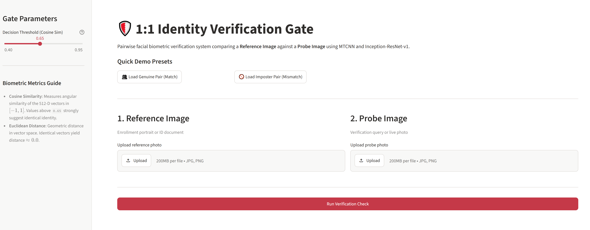
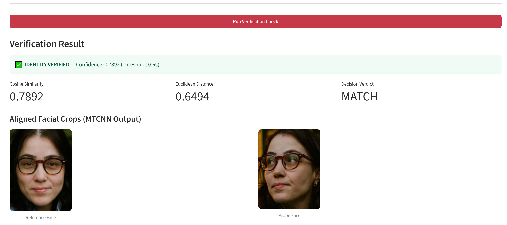
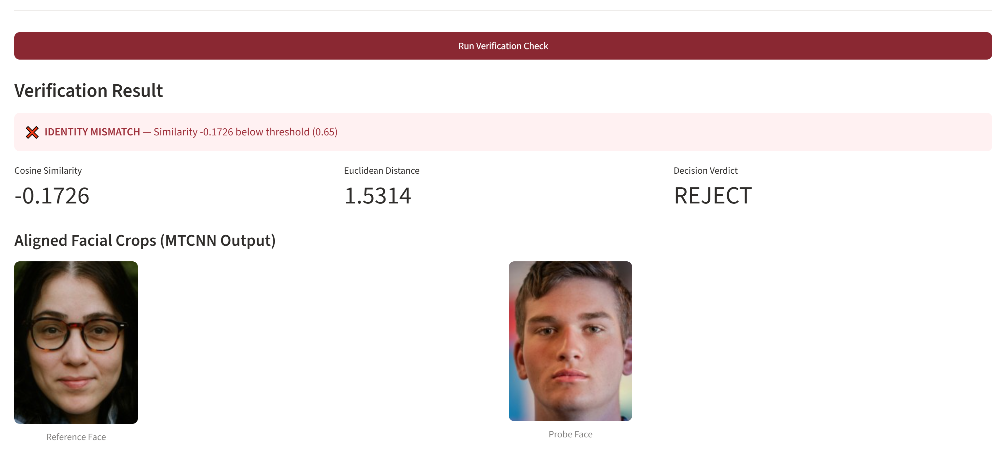

# Identity Verification (Facial Recognition) Gate 🛡️

A lightweight, AI-powered web application that compares two faces to determine if they belong to the same person. This project demonstrates foundational knowledge in Computer Vision and Biometric Facial Recognition.

---

## 📖 What Does This App Do?

Imagine you are opening a new bank account online or unlocking your phone. The system needs to prove that the person holding the camera is the same person on the official ID card. 

**This application simulates that identity check:**
1. **You upload two photos:** A "Reference" photo (like an ID card or a clear portrait) and a "Probe" photo (like a casual photo or a selfie).
2. **The AI finds the faces** in both images, crops them, and lines up the eyes and nose.
3. **It creates a "digital fingerprint"** for both faces.
4. **It compares the fingerprints mathematically.** If they are close enough, the app outputs a green **Match** (Verified). If not, it outputs a red **Mismatch** (Rejected). 

### 📸 App Screenshots

**1. The Verification Gate Interface (Ready for Upload)**
> *Users can upload two photos side-by-side or click the demo buttons.*
>  

**2. Successful Verification (Match Case)**
> *The AI successfully matches two different photos of the same person.*
>  

**3. Identity Mismatch (Imposter Case)**
> *The AI correctly rejects photos of two different people.*
>  

---

## 👨‍💻 Technical Overview (For Developers)

This project uses deep learning to perform an end-to-end face verification pipeline. Instead of relying on a pre-saved database of users (1:N search), it compares two distinct images dynamically in real-time (1:1 matching).

### 🌟 How It Works Under the Hood
* **Face Detection & Alignment (`MTCNN`):** The app first scans the image to find a human face. It detects facial landmarks (eyes, nose, mouth) to crop and perfectly center the face. If it finds zero faces or multiple faces, it throws an error to maintain security.
* **Feature Extraction (`Inception-ResNet-v1`):** The cropped face is passed through a neural network that converts the facial geometry into a 512-dimensional vector (an embedding). 
* **Metric Comparison:** The app calculates the **Cosine Similarity** between the two vectors. If the similarity score is above the set threshold (e.g., 0.65), the system considers it a match.

### 🛠️ Tech Stack
* **Language:** Python
* **Frontend UI:** Streamlit (For rapid, interactive dashboard creation)
* **Computer Vision Backbone:** `facenet-pytorch` (MTCNN & InceptionResnetV1)
* **Image Processing:** Pillow (PIL)
* **Math & Tensors:** PyTorch (Configured for lightweight CPU inference)

---

## 🚀 Setup Instructions

Follow these steps to run the application locally or in a GitHub Codespace. 
*(Note: Ensure you are using Python 3.12 for library compatibility).*

### 1. Clone & Install Dependencies

```bash
git clone https://github.com/danielxycai/face-recog.git
cd face-recog

# Create and activate a virtual environment
python3 -m venv .venv
source .venv/bin/activate  # On Windows use `.venv\Scripts\activate`

# Install required packages (Uses CPU-only PyTorch for fast setup)
pip install --upgrade pip
pip install -r requirements.txt
```

### 2. Launch the Web Application

Start the Streamlit UI:

```bash
streamlit run app.py
```
*The app will automatically open in your browser at `http://localhost:8501`.*

---

## 📷 Acknowledgments & Assets

* **Demo Images:** The pre-loaded demo photos used in this project's `demo_images/` folder were sourced from **Unsplash**, which grants a license allowing these photos to be freely used for personal and portfolio projects. 